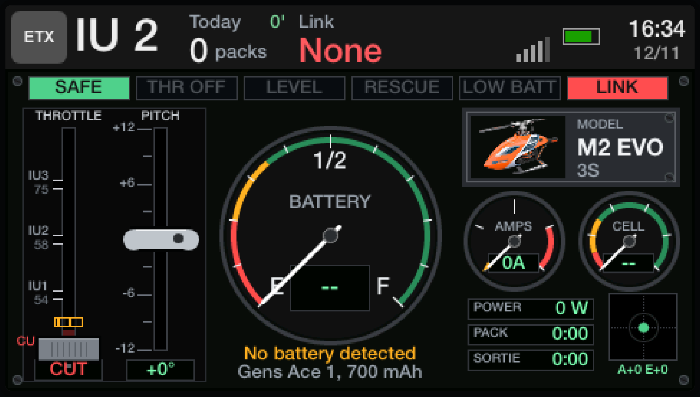
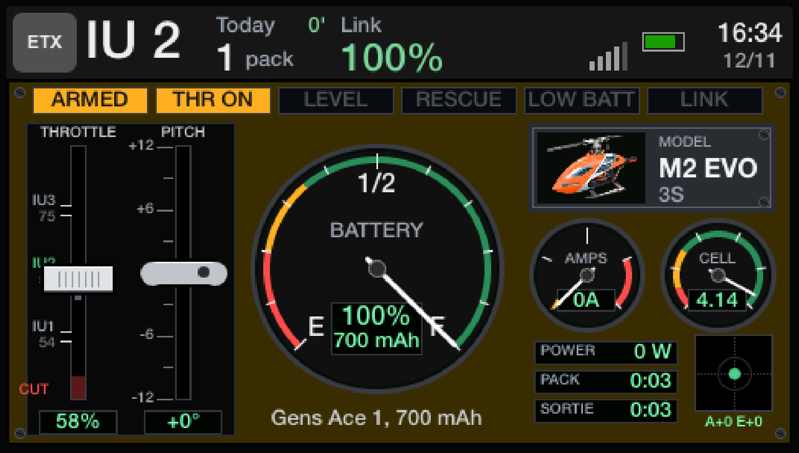

# EdgeTX

The RadioMaster TX16S's SD card, its widgets written in TypeScript (turned into Lua with TypeScriptToLua), and the
scripts that change its models. Flightdown shows and runs it (see Preview).

| Safe, no battery                                       | Armed, throttle on, a full pack                                          |
| ------------------------------------------------------ | ------------------------------------------------------------------------ |
|  |  |

The M2 EVO's screen (the Cockpit widget under the top bar), as Flightdown's Radio tab draws it.

`sd-card/` is the card as it should be: the card as of 10 November 2026, after the update to EdgeTX 2.12.5, with the
model changes of `scripts/` made to it, and the widgets built from `src/` and the edited mAhRe in it. Its only model is
the M2 EVO: the others left the radio on 12 November 2026 and are in this repo's history. `npm run build`
puts the built widgets there (`widgets.json` says which folder each goes in), with the Cockpit's panel
(`scripts/cockpit-panel.mjs` draws its fixed parts as pictures, cheaper for the radio than drawing them each
frame); `npm run dev` rebuilds the widgets into `output/` on every save. Full card copies taken from the radio stay
out of git (`backups/`, `update-2.12.5/`).

- **Cockpit:** the M2 EVO's whole screen as a heli's instrument panel: warning lights (SAFE or ARMED, THR ON or OFF,
  LEVEL, RESCUE, LOW BATT, LOW VOLT or NOT FULL, TELE), the throttle as a quadrant (a detent per idle up, evenly spaced, CUT
  guarded in hold) and the pitch as a collective against a degree scale, the battery as a fuel gauge (from the charge a
  pack had when plugged in, by its volts a cell, less the mAh used; the mAh left under the %, the % said every 10% with
  mAhRe's sounds, the pack the 6-position buttons pick under it; three buzzes every 15 s under 25% with the motor on;
  "low battery" and two buzzes once a cell has spent about 2 s under 3.30 V under load, counted over the last few
  seconds, so short dips add up), the model's data plate, a First Limit Indicator (as
  on Airbus helicopters: one needle for whichever limit comes first, the current against the pack's 30C, the cell from
  4.2 V down to 3.3 V or the charge used against 80 %, 10 at the limit, its letter saying which, its highest marked)
  and the average volts a cell as gauges, the amps, the power and the pack's peak current, and the right stick as a
  cyclic dot (the timers are in the top bar). The panel turns dark yellow while the motor can
  spin, LEVEL lights blue, RESCUE and TELE white on dark red. Built from EdgeTX's LVGL objects, so the radio redraws
  only what changes, and the screen keeps up at 20 frames a second (EdgeTX's most).
- **ArmedModel:** the arming state at a glance: SAFE (grey-green), ARMED (amber, throttle cut) or LIVE (red, the border
  blinking), the SA and SF switches as two lights, the model's picture, and its main rotor seen from above in the
  state's colours: still when safe, spooling up when live (a blur and the rotor disc show as it gains speed), coasting
  down after a cut. Red with RESCUE, its border blinking fast, while SH (the rescue) is held.
- **Pack:** the pack in the heli, picked with the 6-position buttons (its names and sizes at the top of `src/pack.ts`),
  volts a cell now and the lowest, % left from the mAh used, and the last minute of volts a cell as a line.
- **FlyTimer:** time in the air on this pack, counted only while it draws over 2 A, towards a time to land at.
- **Power:** amps on a round dial with the peak, and watts.
- **Link:** RSSI and link quality as bars, amber then red at the radio's alarm levels; the link quality alone in the
  top bar, in %, under "Tele".
- **FlightState:** the gyro (SC) and the throttle hold (SF) as two lights (the flight mode is in the top bar); RESCUE in
  red while SH is held.
- **FMStatus** (in the top bar): the idle up on SE (IU 1 to 3), lit while the gyro (SC) is on; RESCUE in red while SH
  is held.
- **Session:** packs flown and time in the air today, kept across power cycles in global variables 1 to 3; both
  small in the top bar.
- **Timers** (in the top bar): the time with the motor on this pack (timer 1) over the sortie's, today's (timer 2),
  which the Cockpit starts again each day.
- **mAhRe** (RCdiy's Lua in `sd-card/WIDGETS/mAhRe`, edited): battery left in mAh and %, the pack's size and name
  taken from the 6-position button pressed for it (`PACKS` at its top, the same as Pack's), not from GV7. Redrawn in
  the other widgets' colours: a bar of what is left with its %, volts a cell, NOT FULL when the pack was not. Its
  checks (pack not full, cells apart) start again on each new pack instead of on a reset switch.

Pack, FlyTimer, Power, Session and mAhRe start again on a new pack: its voltage back with the mAh count at 0. The
models reset that count only when telemetry stops while disarmed, so a telemetry dropout in flight is not a new pack.

## Deploy

`scripts/deploy.sh` makes the radio's card, plugged in as USB storage, what `sd-card/` is. It runs on it the scripts
that changed the models here, each one skipping a change already there: the M2 EVO's low-cell alarm (`cell_alarm.py`),
its SA sounds (`m2evo_screen.py`), its one cockpit screen and top bar (`cockpit_screen.py`), the 6-position buttons
freed for the packs and set up as a 6-position switch again (`six_pos.py`), the mAh count and timer 1 kept through a
dropout (`disarmed_reset.py`), timer 1 counting up the time with the motor on (`timer_up.py`), the theme's mid grey top
bar, whose colour is also the menus' text (`readable_menus.py`), arming with SA down instead of up (`arm_down.py`),
timer 2 for the sortie (`sortie_timer.py`), the low-cell alarm only with a pack in (`cell_alarm_live.py`) and only for
real sag, 3.30 V a cell for 5 s (`cell_alarm_sag.py`), then off, as the Cockpit warns instead (`cell_alarm_off.py`), a rescue that climbs after 0.1 s of flat pitch, not 0.2 s
(`rescue_delay.py`), the receiver's sensors back in their slots when the radio finds them under new IDs
(`sensor_ids.py`), a theme of its own, Cockpit, with a dark top bar and readable menus (`cockpit_theme.py`, FM2M
Concrete stays to go back to), the Timers widget in the top bar's empty zone (`topbar_timers.py`). Then it copies the
built widgets and mAhRe from `sd-card/`. It backs up what it changes in `backups/<date>` first, and names any model the
radio changed since, to copy into `sd-card/MODELS`. A new model
change is a new script, run on `sd-card/` and added to the deploy.

## Preview

[Flightdown](https://github.com/ValentinMumble/flightdown)'s Radio tab reads `sd-card/` from this repo (on GitHub, or
the checkout beside it) and runs it in a TX16S screen in the browser (Lua in JavaScript, with Fengari): "Model
screens" the models' screens, "Logic" what each switch and channel does, "One widget" a built widget in a zone of its
size. With `npm run dev` running here and in Flightdown, it reloads a widget on every save.
