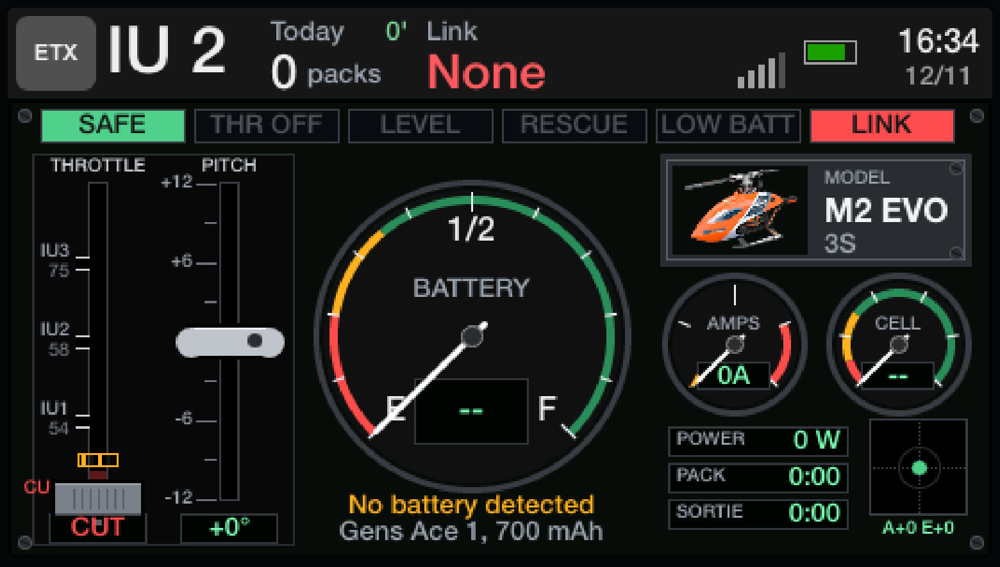
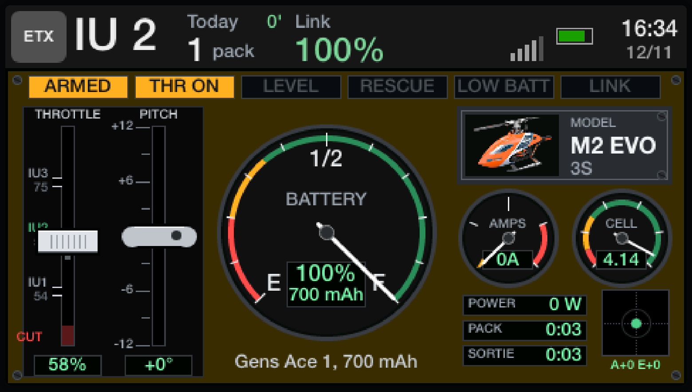

# EdgeTX

The RadioMaster TX16S's SD card, its widgets written in TypeScript (turned into Lua with TypeScriptToLua), and the
scripts that change its models. Flightdown shows and runs it (see Preview).

| Safe, no battery                                       | Armed, throttle on, a full pack                                          |
| ------------------------------------------------------ | ------------------------------------------------------------------------ |
|  |  |

The M2 EVO's screen (the Cockpit widget under the top bar), as Flightdown's Radio tab draws it.

Moving to a RadioMaster GX10: the plan and checklist are in [docs/gx10-migration.md](docs/gx10-migration.md).

`sd-card/` is the card as it should be: the card as of 10 November 2026, after the update to EdgeTX 2.12.5, with the
model changes of `scripts/` made to it, and the widgets built from `src/` and the edited mAhRe in it. Its models are
the M2 EVO and the K110S (below); the others left the radio on 12 November 2026 and are in this repo's
history. `npm run build`
puts the built widgets there (`widgets.json` says which folder each goes in), with the cockpits' panels
(`scripts/cockpit-panel.mjs` draws their fixed parts as pictures, cheaper for the radio than drawing them each
frame); `npm run dev` rebuilds the widgets into `output/` on every save. Full card copies taken from the radio stay
out of git (`backups/`, `update-2.12.5/`).

- **Cockpit:** the M2 EVO's whole screen as a heli's instrument panel: warning lights (arming and the throttle as one guarded toggle in its box: its red guard closed over
  it while SAFE, swinging up once ARMED, the lever flipping up for THR ON, the box lit green, amber or red, UNARMED (THR ON small under it) in amber when
  disarmed with the throttle on;
  LEVEL, RESCUE, LOW BATT, LOW VOLT or NOT FULL, TELE), the throttle as a quadrant (a detent per idle up, evenly spaced, CUT
  guarded in hold, what S1 adds on the lever's knob) and the pitch as a collective against a degree scale, the battery as a fuel gauge (from the charge a
  pack had when plugged in, by its volts a cell, less the mAh used; the mAh left under the %, the % said every 10% (50% with two buzzes) with
  mAhRe's sounds, the pack the 6-position buttons pick under it; three buzzes every 15 s under 25% with the motor on;
  "low battery" and two buzzes once a cell has spent about 2 s under 3.30 V under load, counted over the last few
  seconds, so short dips add up), the model's data plate, the curves as the K110Cockpit draws them: the idle ups' flat
  throttle lines (FM1 to FM3, the governor's head speeds), the one SE picks lit green with what S1 adds, and the pitch
  curve flown over them in blue (the idle up's CP1 to CP3, or CPL while LEVEL is lit), read from the model, with dots at
  the collective stick and the pitch sent, and the most pitch it gives, the average volts
  a cell as a gauge, and the cyclic: a ring at the right stick, a dot at what is sent after rates and expo, the rudder
  the same way on a track under it, the values sent (A, E, R) below (the timers
  are in the top bar). The panel turns dark red while the motor can
  spin, LEVEL lights blue, RESCUE and TELE white on dark red, a green dot in TELE's box while telemetry comes in. Built from EdgeTX's LVGL objects, so the radio redraws
  only what changes, and the screen keeps up at 20 frames a second (EdgeTX's most).
- **K110Cockpit:** the K110S's whole screen, laid out as the Cockpit so nothing moves when switching models: the
  same lights (LEVEL in 6G; RESCUE while SH is held; TELE stays dark; LOW BATT under 30 s left on the Pack timer; "battery 50 %" and two buzzes at 3:30 flown, when its resting volts say a pack is half used), quadrant
  (detents LOW, IU2, IU3 at their curves' mid stick throttle) and collective, the Pack timer as the fuel gauge (the time
  left, how fast it counts now, the XK pack the 6-position buttons pick under it), the data plate (1S), the throttle curves in the pitch curve's box
  (Low RPM, IU2, IU3, the one on SE lit green with a dot at the stick) and that idle up's pitch curve over them in blue
  (CPL in Low RPM, the stick straight in IU2 and IU3) with a dot at the pitch sent, all read from the model, the idle
  ups as three tiles in SE's order where the cell gauge is, and the cyclic and rudder (the stick's mark, what is sent).
- **ArmedModel:** the arming state at a glance: SAFE (grey-green), ARMED (amber, throttle cut) or LIVE (red, the border
  blinking), the SA and SF switches as two lights, the model's picture, and its main rotor seen from above in the
  state's colours: still when safe, spooling up when live (a blur and the rotor disc show as it gains speed), coasting
  down after a cut. Red with RESCUE, its border blinking fast, while SH (the rescue) is held.
- **Pack:** the pack in the heli, picked with the 6-position buttons (its names and sizes at the top of `src/pack.ts`),
  volts a cell now and the lowest, % left from the mAh used, and the last minute of volts a cell as a line.
- **FlyTimer:** time in the air on this pack, counted only while it draws over 2 A, towards a time to land at.
- **Power:** amps on a round dial with the peak, and watts.
- **Link:** RSSI and link quality as bars, amber then red at the radio's alarm levels; the link quality alone in the
  top bar, in %, under "Tele".
- **FlightState:** the gyro (SC) and the throttle hold (SF) as two lights (the flight mode is in the top bar); RESCUE in
  red while SH is held.
- **FMStatus** (in the top bar): the idle up on SE (IU 1 to 3), LOW while its third source is on (the K110S's Low
  RPM), on the M2 EVO what S1 adds under it (amber off the middle), lit while the gyro (SC) is on; RESCUE in red while
  SH is held.
- **Session:** packs flown and time in the air today, kept across power cycles in global variables 1 to 3; both
  small in the top bar.
- **Timers** (in the top bar): the time with the motor on this pack (timer 1) over the sortie's, today's (timer 2),
  which the Cockpit starts again each day.
- **mAhRe** (RCdiy's Lua in `sd-card/WIDGETS/mAhRe`, edited): battery left in mAh and %, the pack's size and name
  taken from the 6-position button pressed for it (`PACKS` at its top, the same as Pack's), not from GV7. Redrawn in
  the other widgets' colours: a bar of what is left with its %, volts a cell, NOT FULL when the pack was not. Its
  checks (pack not full, cells apart) start again on each new pack instead of on a reset switch.

Pack, FlyTimer, Power, Session and mAhRe start again on a new pack: its voltage back with the mAh count at 0. The
models reset that count only when telemetry stops while disarmed, so a telemetry dropout in flight is not a new pack;
Session also wants it gone 15 s, so a dropout before take-off is not counted either.

**The K110S** (`model21.yml`, Futaba S-FHSS, no telemetry), switched as the M2 EVO: SA down arms, SF holds, SC down
is 6G (self-level, else 3D), SE picks the idle up: IU1 (up) Low RPM (a steady 55%, 60 at the stick's ends; soft pitch,
CPL, -80% to +48%, hovering at about +12% stick), IU2 65% (70 at the ends; pitch CP2, -52% to +60%, gentle around a hover at IU1's stick, so switching does not sink it, `k110s_iu2_softer.py`), IU3 90% (pitch CP3, ±90%), each throttle a gentle V and every idle up
hovering at about +25% stick (`k110s_low_speed.py`, `k110s_low_pitch.py`, `k110s_low_inverted.py`, `k110s_low_hover.py`,
`k110s_low_softer.py`, `k110s_low_centre.py`, `k110s_iu2_power.py`, `k110s_iu2_lower.py`, `k110s_low_lower.py`, `k110s_idle_pitch.py`). SB does nothing. SH held is a rescue, built
as the M2 EVO's: 6G, the pitch flat, then +40% after 0.1 s (`k110s_rescue.py`, `k110s_rescue_softer.py`). Its failsafe: No pulses (`k110s_failsafe.py`). Its Pack timer counts down 4:00 of
real flying time (`k110s_timer_real.py`; it counted by throttle before, on CH9, which stays unused) and stops in hold; it starts again while disarmed. Its screen: the K110Cockpit under the top bar. It logs to the
card once the motor may run (armed, out of hold) for 3 s in a row, a line every 0.2 s (sticks, switches, outputs; no
battery, as it has no telemetry): S-FHSS is one-way, so the radio cannot tell the heli is on, and switches flipped on
the bench each made a log.

## Deploy

`scripts/deploy.sh` makes the radio's card, plugged in as USB storage, what `sd-card/` is. It runs on it the scripts
that changed the models here, each one skipping a change already there: the M2 EVO's low-cell alarm (`cell_alarm.py`),
its SA sounds (`m2evo_screen.py`), its one cockpit screen and top bar (`cockpit_screen.py`), the 6-position buttons
freed for the packs and set up as a 6-position switch again (`six_pos.py`), the mAh count and timer 1 kept through a
dropout (`disarmed_reset.py`), timer 1 counting up the time with the motor on, on models with telemetry (`timer_up.py`), the theme's mid grey top
bar, whose colour is also the menus' text (`readable_menus.py`), arming with SA down instead of up (`arm_down.py`),
timer 2 for the sortie (`sortie_timer.py`), the low-cell alarm only with a pack in (`cell_alarm_live.py`) and only for
real sag, 3.30 V a cell for 5 s (`cell_alarm_sag.py`), then off, as the Cockpit warns instead (`cell_alarm_off.py`), a rescue that climbs after 0.1 s of flat pitch, not 0.2 s
(`rescue_delay.py`), the receiver's sensors back in their slots when the radio finds them under new IDs
(`sensor_ids.py`), a theme of its own, Cockpit, with a dark top bar, readable menus and a muted orange focus and logo (`cockpit_theme.py`, FM2M
Concrete stays to go back to), the Timers widget in the top bar's empty zone (`topbar_timers.py`), the log kept
going while armed, so a telemetry gap does not split a pack in two files (`continuous_log.py`), S1 a head speed
knob of -20 to +20% in every idle up (10 in idle up 3, so it tops out at +60, OMPHobby's highest) with a
start warning to set it at the middle (`s1_knob.py`), the idle ups' head
speeds (`idle_ups.py`: FM1 8, FM2 20, FM3 50 % on CH3), the K110S model
when the card has none (`k110s_model.py`), its IU1 made Low RPM and SB freed (`k110s_iu1_low.py`), its log from 3 s
of motor on (`k110s_log.py`), its one cockpit screen (`k110s_screen.py`) and its picture cut out as the M2 EVO's
(`k110s_picture.py`), the M2 EVO's failsafe cutting the motor on a lost link while the rest holds
(`m2evo_failsafe.py`), each model's pre-flight checklist as its notes, no longer shown when it loads (`sd-card/MODELS/M2_EVO.txt`
and `K110S.txt`, `checklists.py` then `checklists_off.py`; each also holds its sim calibration flight plan, for now), the inactivity alarm after 10 minutes untouched (`inactivity_alarm.py`), and practice
rates on SG up (moved from SD, `practice_on_sg.py`, then to SG up, `practice_sg_up.py`, easier to flip back to land; SG wanted down at start-up, `sg_warning.py`; "low rates" said on arming with SG up, `practice_arm_warning.py`) for soft landings on both models: cyclic 55 %, rudder 65 % (`practice_lower.py`, from 70 and 80), a gentler pitch curve CPP keeping the hover
pitch where it is (-3° to +8°, 25 % gentler since 25 Nov 2026, `practice_pitch_gentler.py`; Low RPM keeping its own), "low rates" said, the whole cockpit dark blue, a blue frame and PRACTICE with its rate (the Prac lines' weight) on the cockpits
(`practice_rates.py`), and the K110S's Low RPM pitch hovering at mid stick, 30 % gentler (`k110s_low_pitch.py`). Then it
copies the
built widgets and mAhRe from `sd-card/`. It backs up what it changes in `backups/<date>` first, and names any model the
radio changed since, to copy into `sd-card/MODELS`. A new model
change is a new script, run on `sd-card/` and added to the deploy.

## Preview

[Flightdown](https://github.com/ValentinMumble/flightdown)'s Radio tab reads `sd-card/` from this repo (on GitHub, or
the checkout beside it) and runs it in a TX16S screen in the browser (Lua in JavaScript, with Fengari): "Model
screens" the models' screens, "Logic" what each switch and channel does, "One widget" a built widget in a zone of its
size. With `npm run dev` running here and in Flightdown, it reloads a widget on every save.
